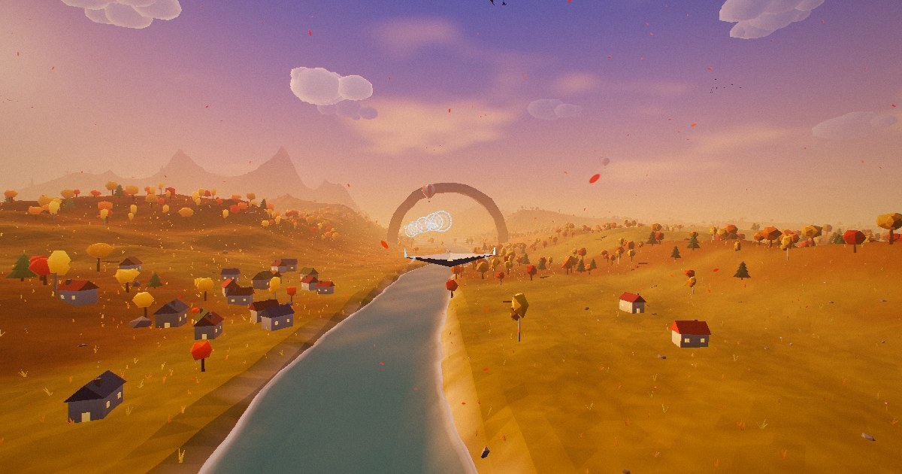

# Infinite Flyover

An endless, procedurally generated flyover you can play in the browser. You glide forever
through lands that never repeat. The day turns to night along the way, and you can thread
rings of light for points.

**Play it:** https://cportka.github.io/infinite-flyover-terrain/



## What's in it

- **Infinite terrain.** The world is streamed in 256 m chunks with three levels of detail,
  generated off the main thread in Web Workers. A floating origin keeps rendering precise
  even after many hours of flight.
- **Seven biomes** that follow one another along the journey: Verdant Vale, Azure Coast,
  Amethyst Wilds, Frostpeak Range, Ember Mesa, Autumn Hollow and Cinder Fields. Each one
  has its own terrain shape, palette, props, water (or lava), particles, atmosphere and
  music.
- **Full of stuff.** There are forests, villages with lit windows, palms, cacti, hoodoos,
  giant glowing mushrooms, crystals, ruins, natural arches spanning the valley, ring gates,
  floating islands, hot-air balloons, sailboats, lighthouses, flocks of birds and drifting
  clouds.
- **Shaders.** Fog fades into the exact sky colour behind each fragment, including height
  fog. Water has waves, Fresnel sky reflections, sun glints and foam along the shore, and
  the lava flows. The sky has a day/night cycle with sunsets, stars, a moon and aurora.
  Wind sways the foliage, cloud shadows drift over the ground, mesa strata are painted per
  pixel, and the final image goes through bloom, ACES tone mapping and grading.
- **A light game on top.** You steer the glider through rings to build combos, and golden
  rings are worth more. Boost burns energy that rings refill. If you stop steering, the
  autopilot takes over. Zen mode just flies and lets you watch.
- **Generative soundtrack.** It's synthesised live with WebAudio: a pad, chimes and wind
  for each biome, plus sound effects. The game ships no audio assets at all.

## Controls

| Action | Keyboard / gamepad | Touch / mouse |
| --- | --- | --- |
| Steer | `W` `A` `S` `D` / arrow keys / left stick | Drag anywhere |
| Boost | `Space` / `Shift` / A / RT | Hold the **Boost** button (or a second finger) |
| Camera (chase, cinematic, cockpit) | `C` | Pause menu |
| Pause and settings | `P` / `Esc` | ❚❚ button |
| Mute | `M` | ♪ button |
| Hide the HUD (photo mode) | `H` | – |
| Skip ahead in time | `T` | – |

## URL parameters

These are handy for sharing a world or jumping straight to a scene:

- `?seed=12345` picks a different world. "New world" in the pause menu does the same.
- `?t=0.75` sets the starting time of day (0 is midnight, 0.25 sunrise, 0.5 noon, 0.75 sunset).
- `?s=14600` sets the starting distance along the journey in metres. Each biome region is
  about 3.2 km long.
- `?play` / `?zen` skip the title screen.
- `?quality=low|medium|high` forces a quality preset. `auto` is the default.
- `?cam=chase|cinematic|cockpit` picks the camera.
- `?debug` logs FPS, chunk and draw-call stats to the console.

## Development

Requires Node 20.19+ (CI uses Node 22).

```bash
npm install
npm run dev       # local dev server
npm test          # world-generation tests (node --test)
npm run build     # production build into dist/
npm run preview   # serve the production build
```

### Project layout

```
src/
  main.js               bootstrap, game loop, floating origin, settings
  world/
    noise.js            seeded simplex noise + hashing
    biomes.js           biome catalogue (terrain params, palettes, atmosphere, particles)
    terrain.js          flight path, biome regions, terrain height field, valley carving
    props.js            procedural low-poly props and landmarks
    chunkBuilder.js     chunk meshes: terrain + skirts, water/lava, baked props
    chunkWorker.js      Web Worker wrapper
    chunkManager.js     LOD streaming, worker pool, GPU uploads
  render/
    shaderLib.js        shared GLSL: sky colour, aerial-perspective fog, periodic noise
    materials.js        terrain, prop and water shaders
    sky.js              sky dome: sun, moon, stars, aurora, high clouds
    atmosphere.js       day/night palette keyframes, sun path, biome tints
    ambient.js          particles, cloud banks, bird flocks
    postfx.js           bloom + final grade (ACES, vignette, grain, aberration)
  game/                 player/glider + camera, rings, input, audio
  ui/                   HUD controller + styles
tests/                  node --test suites for the world generator
```

## Deployment

`.github/workflows/deploy.yml` tests and builds every pull request. Every push to `main`
is also deployed to GitHub Pages with `actions/deploy-pages`.

To turn it on once, go to **Settings → Pages → Build and deployment** and set **Source**
to **GitHub Actions**. After that, every merge to `main` publishes the site.

The Vite build uses a relative base (`./`), so it works from the project sub-path
(`/infinite-flyover-terrain/`) or from a custom domain without any changes.
